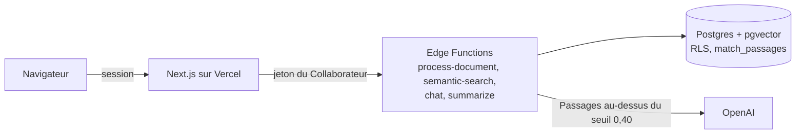

# NexaMind AI

Le copilote documentaire de NexaWorks : un MVP réalisé en Vibe Coding.

## Le besoin et la réponse

Chez NexaWorks, le savoir de l'entreprise est éparpillé entre les procédures, les FAQ, les notes de réunion et les comptes rendus clients. Les Collaborateurs perdent du temps à le chercher et obtiennent des réponses différentes selon la personne qu'ils interrogent.

NexaMind AI réunit ce savoir dans une Base commune. Un Collaborateur ajoute un Document en une minute. Tout Collaborateur peut ensuite poser une question avec ses mots et obtenir une réponse rédigée à partir des Documents de l'entreprise, avec des Sources cliquables pour vérifier. Si l'information n'existe pas, l'Assistant le dit au lieu d'inventer.

## Démonstration

- **URL** : https://projet-ia-six.vercel.app
- **Comptes de démonstration A et B** : identifiants transmis avec le rendu, jamais écrits dans le dépôt.

## Stack

- **Application** : Next.js 16 (App Router) et React 19, hébergée sur Vercel (région `fra1`)
- **Données** : Supabase (Postgres avec pgvector, Auth, Storage privé, RLS, Edge Functions), région `eu-central-1`
- **IA** : OpenAI `gpt-5.4-mini` (génération) et `text-embedding-3-small` (vectorisation, 1 536 dimensions), appelés uniquement depuis les Edge Functions
- **Tests** : Vitest et Playwright (avec axe pour l'accessibilité)

## Chaîne RAG



Le navigateur ne parle qu'à Next.js et au Storage. La clé OpenAI n'existe que dans les secrets Supabase. La démarche, les décisions et les mesures sont détaillées dans le [dossier de démarche](docs/demarche-vibe-coding.md).

## Installation locale

Prérequis : Node.js 24, Docker Desktop démarré et CLI Supabase 3.0.0.

```bash
npm install
npm run check:env          # vérifie Docker et la CLI Supabase
npx supabase start         # démarre la pile Supabase locale
```

Créez ensuite `.env.local` avec `NEXT_PUBLIC_SUPABASE_URL` et `NEXT_PUBLIC_SUPABASE_PUBLISHABLE_KEY` (valeurs affichées par `npx supabase start`), puis lancez :

```bash
npm run dev                # http://localhost:3000
```

En local, la vectorisation et la génération sont simulées : aucune clé OpenAI n'est nécessaire. La liste complète des variables (noms seulement) est dans [docs/environnements.md](docs/environnements.md).

## Commandes

| Commande | Effet |
|---|---|
| `npm run dev` | Serveur de développement |
| `npm test` | Tests Vitest : unitaires, puis intégration sur Supabase local |
| `npm run test:e2e` | Tests Playwright sur Supabase local (build de production dédié) |
| `npm run lint` | ESLint |
| `npm run check:secrets` | Cherche des formats de clés dans le dépôt |
| `npm run build:ci` | Contrôle des secrets, build, contrôle du code envoyé au navigateur |
| `npm run test:ai` | Vérifie l'accès aux modèles par la fonction locale (clé locale requise) |

Les tests réels sur la production (`test:search:live`, `test:chat:live`, `test:followup:live`, `test:summary:live`, `test:uj2:live`, `test:security:live`, `measure:all`) consomment du crédit d'IA. Leurs prérequis sont décrits dans [docs/environnements.md](docs/environnements.md).

## Déploiement

1. **Supabase d'abord** : `npm run deploy:supabase` applique les migrations au projet distant lié et redéploie les Edge Functions.
2. **Vercel ensuite** : un push sur `main` déclenche le build (`npm run build:ci`) et le déploiement en production.

Cet ordre est obligatoire : l'application ne doit jamais précéder les migrations. Les secrets se posent sans affichage, suivant les procédures de [docs/environnements.md](docs/environnements.md). Pour recharger le Jeu de démonstration, utilisez `npm run seed:demo`.

## Limites assumées du MVP

- Données fictives : NexaWorks et tous les Documents sont inventés.
- Inscription ouverte, bornée par un quota quotidien et un plafond global de questions.
- Documents .txt et .md de 100 Ko au plus. PDF (FR-6), FR-11, FR-21 et le téléchargement de FR-10 ne sont pas livrés (P1 et P2).
- Le détail des limites est dans le [dossier de démarche](docs/demarche-vibe-coding.md#8-limites-connues).

## Résultats de l'audit de sécurité et décision de mise en service

**Audit de sécurité (story 7.8).** Tout le code a été relu en 5 surfaces par des relecteurs indépendants : aucune fuite de données entre Comptes, aucun contournement de l'authentification, aucun secret exposé. Le seul constat de gravité haute (verrou du Résumé contournable par appel direct de l'API) est corrigé et testé ; 18 constats retenus au total (9 corrigés, 2 acceptés, 7 reportés). Détail et preuves : [audit de sécurité](docs/tests/audit-securite.md).

**Décision de mise en service (story 7.9).** _À compléter après la story 7.9._
