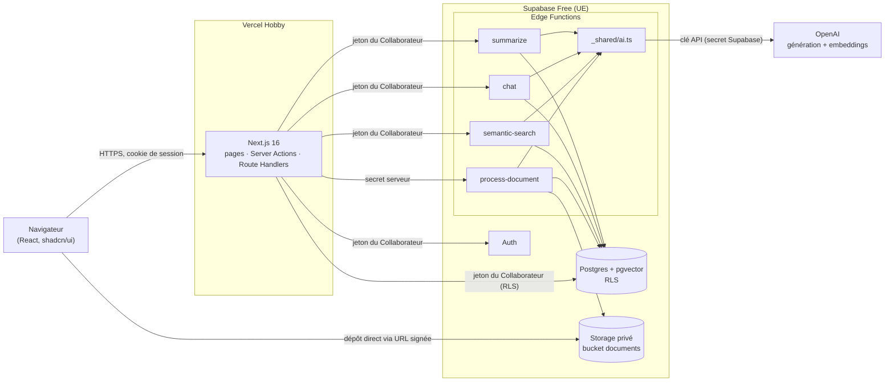
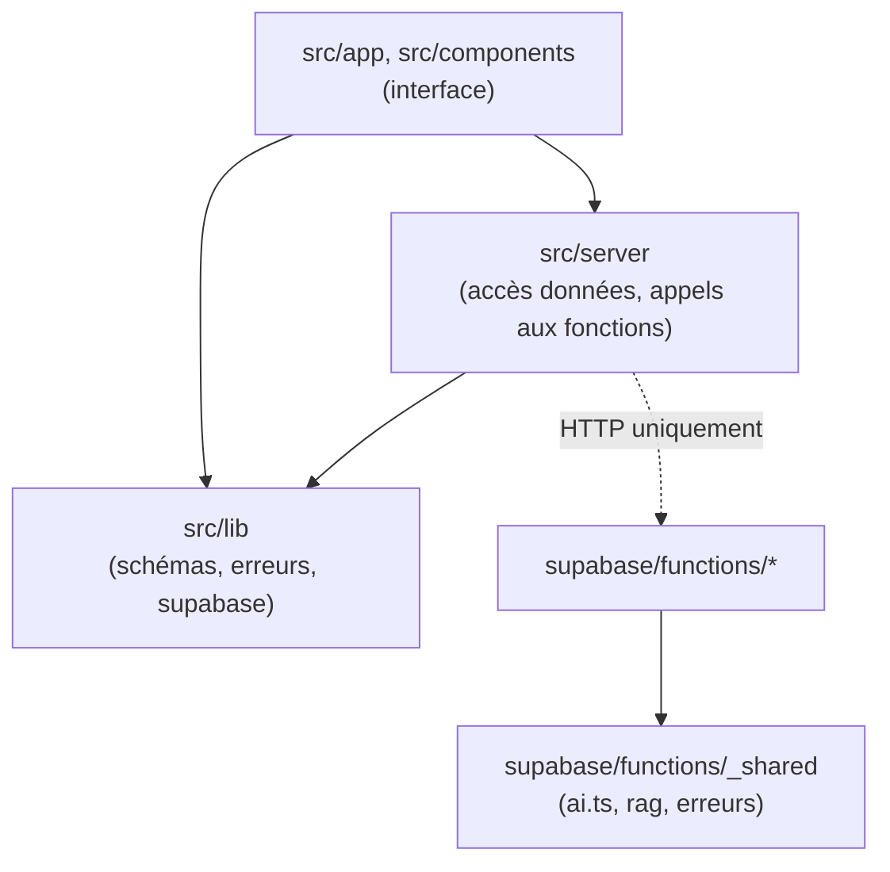
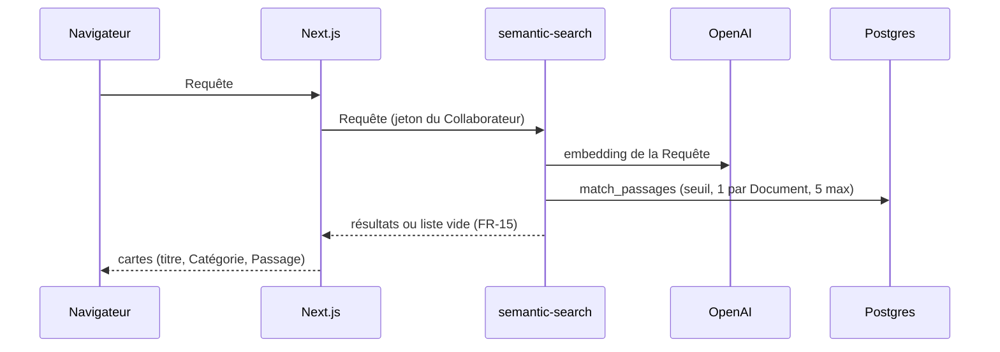
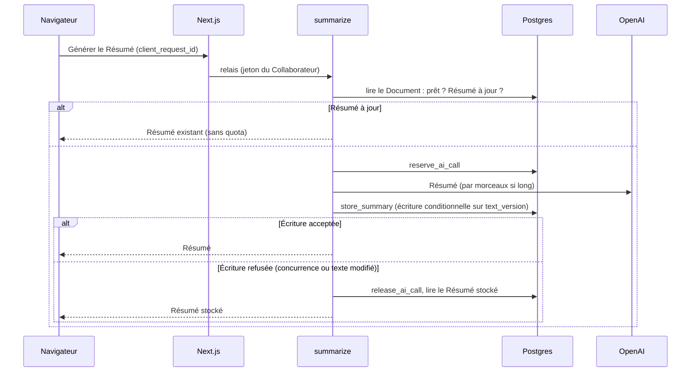
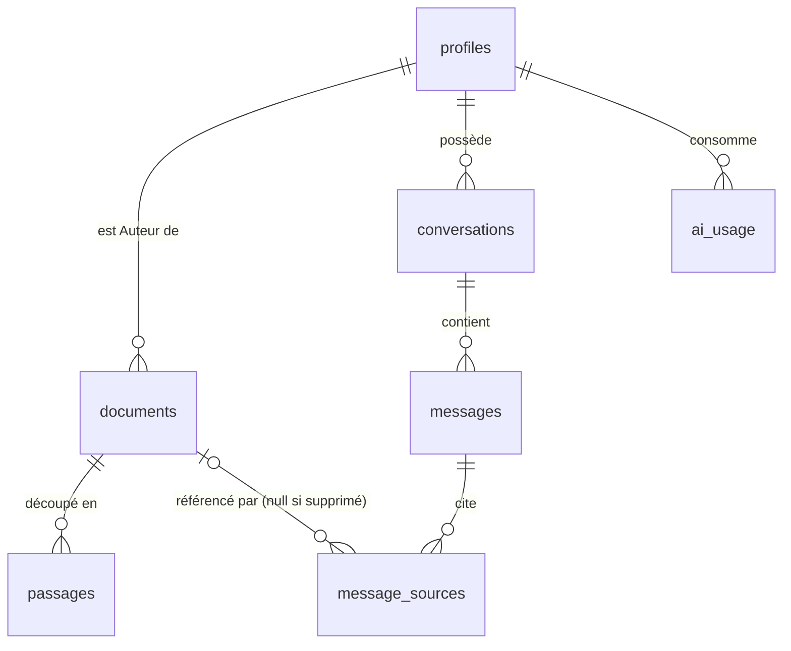

# Architecture — NexaMind AI

Ce document est le contrat technique du MVP. Chaque règle doit pouvoir guider directement une story. Les raisons détaillées sont consignées dans [.memlog.md](.memlog.md). `[ADOPTED]` signale une décision prise par toi ou imposée par l'existant ; `[ASSUMPTION]` signale une valeur de départ à vérifier pendant le développement. Le vocabulaire suit le Glossaire du PRD (§3).

## 1. Vue d'ensemble

**Paradigme.** Next.js est la seule porte d'entrée du navigateur : il sert l'interface et joue le rôle de serveur intermédiaire (BFF). Toute l'IA s'exécute dans des Supabase Edge Functions, qui sont les seules à détenir la clé OpenAI. Postgres est la source de vérité, et chaque accès aux données passe par la sécurité au niveau des lignes (RLS).



**Sens des dépendances** (règle AD-1) :



## 2. Décisions

Format : **Règle** (ce que le développement doit respecter) · **Raison** (la divergence évitée) · **Écarté** · **Risque restant** · **Exigences** (ce que la décision couvre).

### AD-1 — Frontières : le navigateur ne parle qu'à Next.js et au Storage `[ADOPTED]`
- **Règle (Rule) :** le navigateur appelle uniquement Next.js (pages, Server Actions, Route Handlers) et, pour déposer un fichier, une URL signée du Storage. Il n'appelle jamais une Edge Function, ni OpenAI. `src/app` ne contient aucune requête SQL : tout passe par `src/server`. Les Edge Functions n'importent rien de `src/`.
- **Raison — ce qu'on évite (Prevents) :** un seul point de contrôle (session, validation, erreurs) et un seul point d'accès à l'IA.
- **Écarté :** appel direct des Edge Functions depuis le navigateur (contrôles dispersés).
- **Risque restant :** un intermédiaire réseau de plus pour la Recherche et l'Assistant (NFR-3), à mesurer dès la première story concernée. Les URL des Edge Functions sont publiques. Un Collaborateur connecté qui les appellerait directement avec son propre jeton n'obtiendrait rien de plus que par l'interface, car chaque fonction (a) exige un jeton valide, (b) revalide son entrée, (c) applique la RLS et le quota, et (d) ne renvoie jamais la clé. `process-document` refuse tout appel sans `PROCESS_DOCUMENT_SECRET` ; comme il n'est jamais appelé avec un jeton de Collaborateur, il est déclaré `verify_jwt = false` dans `supabase/config.toml`, et seul le secret fait foi.
- **Exigences (Binds) :** NFR-1, NFR-2.

**Chemin d'un appel à l'IA** (règle vérifiable) : navigateur → Next.js (serveur, jeton du Collaborateur) → Edge Function → `_shared/ai.ts` → OpenAI. La clé `OPENAI_API_KEY` n'existe que dans les secrets Supabase. Ni le navigateur ni Next.js ne la voient, et aucune réponse ne la contient.

### AD-2 — Données protégées par RLS avec le jeton du Collaborateur `[ADOPTED]`
- **Règle (Rule) :** RLS est activée sur toutes les tables de `public`. Next.js et les fonctions `semantic-search`, `chat` et `summarize` créent leur client Supabase avec le jeton du Collaborateur. La clé `service_role` n'est utilisée que dans `process-document` et dans le script de préchargement. Les colonnes réservées au système (`status`, `error_kind`, `error_message`, `attempt_id`, `processing_started_at`, `text_version`, `summary_*`, `author_id`, `storage_path`) ne sont pas modifiables par le rôle `authenticated` : un `GRANT UPDATE` ne porte que sur `title` et `category` (plus `content_text` si FR-11). Elles changent uniquement par des fonctions SQL `security definer` (§5). Le rôle `anon` n'a aucun privilège sur les tables, vues et fonctions de `public` (`REVOKE ALL`), et toutes les politiques sont déclarées `to authenticated`. La vue `documents_list` est `security_invoker = true` et n'expose ni `content_text` ni le Résumé : le texte complet n'est lu que par la page Document et le panneau Source, Document par Document.
- **Raison — ce qu'on évite (Prevents) :** le contrôle d'accès est garanti par la base, même en cas d'appel direct à l'API (FR-2, FR-13, FR-22).
- **Écarté :** contrôles uniquement dans le code serveur.
- **Risque restant :** une politique RLS oubliée. Parade : test d'intégration à deux Comptes sur chaque table (§6).
- **Exigences (Binds) :** NFR-1, FR-2, FR-13, FR-22, SM-6.

### AD-3 — OpenAI via un module unique `_shared/ai.ts` `[ADOPTED]`
- **Règle (Rule) :** tous les appels OpenAI passent par `supabase/functions/_shared/ai.ts`, qui utilise `fetch` sans SDK. Il expose `embed`, `streamAnswer`, `rewriteFollowUp` et `summarize`, et centralise modèles, paramètres, délais, nouvelles tentatives et traduction des erreurs. Next.js ne contient ni clé ni SDK OpenAI. Génération : `gpt-5.4-mini` ; vectorisation : `text-embedding-3-small`. Les tarifs ont été vérifiés le 2026-11-03 sur la page officielle et sont à revérifier avant la démonstration.
- **Raison — ce qu'on évite (Prevents) :** un seul endroit pour changer de fournisseur et protéger la clé (NFR-2, NFR-9).
- **Écarté :** Mistral (alternative documentée si un hébergement européen devient prioritaire) ; Gemini (le palier gratuit exploite les données, plafond de dépense peu fiable).
- **Risque restant :** hébergement des modèles hors UE, sans enjeu pour des données fictives.
- **Exigences (Binds) :** NFR-2, NFR-9, FR-14 à FR-19, FR-23.

### AD-4 — Modèle de vectorisation fixé en configuration et versionné `[ADOPTED]`
- **Règle (Rule) :** `EMBEDDING_MODEL`, `EMBEDDING_DIMENSION` (1 536) et `EMBEDDING_VERSION` sont définis une seule fois dans `_shared/config.ts`. La colonne `passages.embedding` est de type `vector(1536)`. Chaque Passage enregistre `embedding_model` et `embedding_version`. La Recherche et l'Assistant ne lisent que la version active. Toute écriture ou requête vérifie la dimension du vecteur et refuse un écart. Changer de modèle impose de re-vectoriser tous les Documents, et la version active n'est changée qu'une fois la re-vectorisation terminée.
- **Raison — ce qu'on évite (Prevents) :** des Passages et des Requêtes vectorisés différemment ne se comparent pas, et l'erreur serait silencieuse.
- **Écarté :** modèle choisi dans chaque fonction.
- **Risque restant :** une re-vectorisation complète si l'on change de modèle (quelques centimes et quelques minutes pour le Jeu de démonstration). L'outil de re-vectorisation n'est pas prévu dans le MVP.
- **Exigences (Binds) :** FR-14, FR-16, NFR-9.

### AD-5 — Traitement asynchrone dans `process-document` `[ADOPTED]`
- **Règle (Rule) :**
  1. **Création.** Pour une Note, Next.js valide la saisie. Pour un fichier, il vérifie l'objet déjà déposé (AD-7). Il enregistre ensuite le Document avec `status = processing`, un `attempt_id` neuf et `processing_started_at = now()` : le délai de 3 min ne démarre qu'après cette vérification.
  2. **Déclenchement.** Next.js appelle `process-document` (secret `PROCESS_DOCUMENT_SECRET`) et **attend sa réponse**. La fonction contrôle le secret et la tentative, lance le travail avec `EdgeRuntime.waitUntil(…)` et répond aussitôt `202 Accepted`. Aucun `fetch` non attendu. Si l'appel échoue ou ne répond pas en 5 s, Next.js appelle `abandon_processing(document_id, attempt_id)` **avec le jeton du Collaborateur** (Next.js n'a pas la clé `service_role`, AD-20) : le Document passe *en erreur* temporaire et est immédiatement relançable. Il redirige ensuite vers la page Document.
  3. **Travail en arrière-plan.** Extraction, texte canonique, découpage, vectorisation par lots de 96.
  4. **Fin.** Une seule fonction SQL `complete_processing(document_id, attempt_id, …)` remplace les anciens Passages et passe le Document à `ready`, à condition que la tentative soit la tentative courante, *en cours*, et commencée il y a moins de 3 min. Sinon, rien n'est écrit.
  5. **Échec.** `fail_processing(document_id, attempt_id, kind, message)` (`service_role`, appelé par `process-document`), avec `kind` = `temporary` ou `no_text`, soumis à la même condition de tentative courante. Côté Next.js, seul `abandon_processing(document_id, attempt_id)` existe : `security definer`, réservé à l'Auteur, accepté seulement si la tentative est la tentative courante et le Document *en cours* ; il écrit `error_kind = temporary` avec le message du catalogue. Une fin tardive de `process-document` sur cette tentative est ensuite ignorée (étape 4).
  6. **Relance.** `retry_processing` (Auteur seul) se base sur le **Statut effectif** (AD-6). Elle est permise si l'erreur est `temporary`, y compris pour un traitement expiré après 3 min. Elle crée une nouvelle tentative, avec un nouvel horodatage, et repart d'un état propre.
- **Raison — ce qu'on évite (Prevents) :** le traitement ne bloque pas l'interface (addendum). Sur Vercel, un appel non attendu peut être interrompu à la fin de la requête ; ici, le travail continue côté Supabase. Une tentative périmée ne peut jamais remettre un Document à *prêt*.
- **Écarté :** `after()` de Next.js ; `fetch` non attendu ; traitement immédiat dans la requête ; file de tâches dédiée (pgmq), notée comme évolution possible.
- **Risque restant :** limites des Edge Functions du plan gratuit (150 s d'exécution, 2 s de calcul hors attentes réseau). Les fichiers .txt et .md et les Notes sont limités à 100 Ko (100 000 octets, décision du 2026-11-12) : le test de charge de la story 2.7 a montré que l'écriture finale des Passages, en un seul appel à `complete_processing`, est annulée au-delà de 8 s par instruction (`statement_timeout` de la connexion `authenticator` de l'API, dont `service_role` hérite). Marge à surveiller : environ 3 s pour 115 Passages. L'écriture par lots, qui lèverait cette limite, est reportée après l'Epic 5 (§6, §7). Un gros PDF (P2) peut échouer : il passe alors *en erreur* temporaire, sans retarder le P0. En local, la CLI Supabase arrête l'instance après chaque requête : régler `[edge_runtime] policy = "per_worker"` dans `supabase/config.toml`.
- **Exigences (Binds) :** FR-4 à FR-8, NFR-3, NFR-4, X11.

### AD-6 — Statut effectif calculé en base, avec expiration à 3 min `[ADOPTED]`
- **Règle (Rule) :** la vue `documents_list` expose un `effective_status`. `retry_processing`, la page Document et la Bibliothèque se basent tous sur ce Statut effectif. Un Document *en cours* depuis plus de 3 min y apparaît `error`, avec `error_kind = temporary` et le message « Le traitement n'a pas pu aboutir. Vous pouvez le relancer. ». Elle expose aussi `processing_started_at` (horodatage serveur, base des 60 s de l'interface) et `server_now`. L'interface interroge le Statut toutes les 3 s tant qu'un Document affiché est *en cours* ; après 3 échecs consécutifs, elle affiche « Le Statut n'a pas pu être actualisé. » avec « Actualiser ».
- **Raison — ce qu'on évite (Prevents) :** l'expiration est exacte pour tous les Collaborateurs et après un rechargement, sans tâche planifiée.
- **Écarté :** `pg_cron` (une brique de plus) ; minuteur côté navigateur.
- **Risque restant :** une interrogation toutes les 3 s par Document *en cours* reste négligeable à l'échelle de la démo.
- **Exigences (Binds) :** FR-7, NFR-4, X11.

### AD-7 — Fichiers déposés directement dans le Storage privé `[ADOPTED]`
- **Règle (Rule) :**
  1. **Contrôle avant tout envoi.** Dans l'onglet Fichier, le navigateur vérifie l'extension (`.txt`, `.md`, et `.pdf` seulement si FR-6 est livré) et la taille (100 Ko au plus pour `.txt` et `.md`, **100 Ko = 100 000 octets** dans tous les contrôles, décision du 2026-11-12 ; limite des PDF à arbitrer au lancement de E9) dès le choix du fichier (FR-7).
  2. **Dépôt, avant toute création de Document.** Il demande à Next.js une URL d'upload signée (`POST /api/uploads`, qui renvoie un `upload_id`) pour le chemin `{author_id}/uploads/{upload_id}`, puis y dépose le fichier.
  3. **Vérification à « Importer ».** Next.js vérifie, avec le jeton du Collaborateur, que l'objet existe, se trouve dans le dossier du Collaborateur et respecte la taille maximale (100 Ko pour `.txt` et `.md`). Une politique Storage de lecture des métadonnées réservée au propriétaire, limitée à `{auth.uid()}/uploads/…`, le permet ; aucun autre Collaborateur ne lit ce dossier. Il **déduit le type MIME de l'extension** côté serveur (`.txt` → `text/plain`, `.md` → `text/markdown`, `.pdf` → `application/pdf`) et ignore celui envoyé par le navigateur.
  4. **Création.** Le Document est créé (AD-5, étape 1) avec ce `storage_path`.
  5. **Bucket.** Le bucket privé `documents` est limité à 100 000 octets (`file_size_limit`, abaissé le 2026-11-12 ; à relever seulement si la limite des PDF l'exige, au lancement de E9), sans restriction de type MIME au niveau du bucket, car les navigateurs déclarent mal les `.md`. Aucune URL publique. Le téléchargement (P2) passe par une URL signée courte, en pièce jointe.
- **Raison — ce qu'on évite (Prevents) :** aucun fichier ne transite par Next.js (le corps d'une requête Vercel est limité à 4,5 Mo, ce qui laisse de la marge pour une éventuelle limite des PDF). Aucun Document n'existe pour un dépôt raté, et aucun type de fichier n'est accepté sur la seule déclaration du client.
- **Écarté :** envoi du fichier à travers Next.js ; création du Document avant le dépôt ; type MIME déclaré par le navigateur.
- **Risque restant :** un fichier déposé mais jamais importé reste dans `uploads/`. C'est négligeable pour le MVP ; le nettoyage est reporté (Deferred).
- **Exigences (Binds) :** FR-5, FR-6, FR-7, FR-10 (P2), NFR-1.

### AD-8 — Texte canonique, positions et affichage en texte brut `[ADOPTED]`
- **Règle (Rule) :** `documents.content_text` stocke le texte canonique (NFC, fins de ligne `\n`). Il sert à la fois au découpage, aux positions des Passages (`start_offset` et `end_offset` en unités de code JavaScript) et à l'affichage. `text_version` s'incrémente à chaque changement du texte (P1). Le Lecteur de Document affiche ce texte brut, retours à la ligne conservés, avec des nœuds texte React, sans jamais utiliser `dangerouslySetInnerHTML`, et met en évidence les Passages avec des `<mark>`. Si des positions sont invalides, le Document s'affiche sans mise en évidence, avec le message « Passage introuvable ». Les extraits de la Recherche suivent les mêmes règles. Le texte ne contenant que des espaces est traité comme fichier sans texte exploitable (`no_text`). Décodage des `.txt` et `.md` : UTF-8 strict (`TextDecoder('utf-8', { fatal: true })`, BOM retiré). En cas d'échec, repli sur Windows-1252, fréquent pour les fichiers français enregistrés sous Windows. Si le résultat contient encore des caractères de contrôle autres que tabulation et saut de ligne : `no_text` avec le message « Le texte de ce fichier n'a pas pu être lu (encodage non pris en charge). ».
- **Raison — ce qu'on évite (Prevents) :** la mise en évidence reste fiable et le contenu des Documents ne peut injecter ni HTML ni script.
- **Écarté :** Markdown interprété (évolution possible) ; affichage du PDF d'origine.
- **Risque restant :** un `.md` s'affiche avec ses symboles bruts.
- **Exigences (Binds) :** FR-10, FR-14, FR-17, NFR-6, NFR-10.

### AD-9 — Même recherche pour la Recherche sémantique et l'Assistant
- **Règle (Rule) :** une seule fonction SQL `match_passages(query_embedding, min_similarity, max_passages, max_per_document)`, en `security invoker`, ne renvoie que des Passages de Documents `ready` pour la version de vectorisation active. Seuil `RAG_MIN_SIMILARITY` commun aux deux usages. La Recherche garde le meilleur Passage de chaque Document, dans la limite de 5 Documents. L'Assistant prend 8 Passages au plus, dont 3 au plus par Document.
- **Raison — ce qu'on évite (Prevents) :** décision D4 de l'addendum (mêmes Passages), et FR-8 garanti au même endroit.
- **Écarté :** deux requêtes distinctes.
- **Risque restant :** le seuil de départ (0,40) est une hypothèse `[ASSUMPTION]`, à calibrer sur le Jeu de démonstration (SM-2, SM-4, FR-15) dans une story dédiée.
- **Exigences (Binds) :** FR-8, FR-14, FR-15, FR-16, FR-18.

### AD-10 — Marqueur interne à trois valeurs `[ADOPTED]`
- **Règle (Rule) :** la sortie du modèle commence par `REPONSE`, `REFUS_INFO_ABSENTE` ou `REFUS_HORS_CADRE`, seul sur la première ligne. La fonction `chat` **met en mémoire tampon** le début de la sortie, jusqu'au premier saut de ligne ou 40 caractères au plus, et n'envoie rien au navigateur avant d'avoir reconnu le marqueur. Elle le retire et ne l'affiche ni ne le stocke. `REPONSE` : diffusion progressive du texte. Refus : le texte du modèle est ignoré et le message standard correspondant est envoyé en un bloc, sans Source. Marqueur absent ou invalide : panne (`AI_OUTPUT_INVALID`). Une contradiction entre Passages reste une `REPONSE`, signalée dans le texte. Si aucun Passage ne dépasse le seuil, un appel court (sortie limitée au marqueur) départage les deux refus.
- **Raison — ce qu'on évite (Prevents) :** un refus ne s'écrit jamais progressivement (X12), et FR-18 distingue l'information absente du hors cadre.
- **Écarté :** marqueur à deux valeurs ; note de contradiction dédiée.
- **Risque restant :** le premier affichage attend le marqueur, ce qui pèse un peu sur le délai de 5 s (NFR-3).
- **Exigences (Binds) :** FR-16, FR-18, NFR-3, NFR-4, X12.

### AD-11 — Réponse finalisée seulement après validation des citations `[ADOPTED]`
- **Règle (Rule) :** le modèle cite sous la forme `[P{n}]`, où *n* est le numéro d'un Passage transmis. À la fin, `chat` valide chaque citation. Si au moins une est valide : les citations invalides sont retirées et journalisées, les Sources sont regroupées par Document et numérotées dans l'ordre de première citation, puis la réponse est enregistrée. Si aucune n'est valide : `AI_CITATIONS_INVALID`, le texte est retiré de l'écran, rien n'est enregistré comme réponse et aucun quota n'est consommé. Pendant la diffusion, `chat` **masque les marqueurs `[P{n}]`** : il les retire du texte envoyé, en gardant en tampon un `[P` coupé entre deux morceaux. L'interface affiche la réponse comme provisoire jusqu'à l'événement final `done`, qui porte le texte validé, la position des renvois et les Sources ; ce texte remplace alors le texte provisoire. Pas de nouvelle génération automatique.
- **Raison — ce qu'on évite (Prevents) :** aucune réponse sans preuve (FR-17, SM-1, zéro fait inventé).
- **Écarté :** remplacer la réponse par un refus ; régénérer automatiquement.
- **Risque restant :** ce cas compte comme un échec pour SM-1.
- **Exigences (Binds) :** FR-16, FR-17, SM-1.

### AD-12 — Questions de suivi reformulées avant la recherche
- **Règle (Rule) :** si la Conversation contient déjà des échanges, `rewriteFollowUp` produit une question autonome à partir des 3 derniers échanges et de la nouvelle question. La recherche porte sur cette question autonome, enregistrée dans `messages.standalone_question`. La génération reçoit les Passages, les 3 derniers échanges et la question d'origine. La reformulation ne compte pas dans le quota.
- **Raison — ce qu'on évite (Prevents) :** addendum (questions de suivi) et FR-19.
- **Écarté :** chercher sur la question brute.
- **Risque restant :** un appel de plus, donc un peu plus de délai (environ 1 s).
- **Exigences (Binds) :** FR-19, UJ-3.

### AD-13 — Les contenus restent des données `[ADOPTED]`
- **Règle (Rule) :** dans les consignes, chaque Passage est encadré par `<passage id="P{n}" document="{titre}">…</passage>`. Les caractères `<`, `>` et `&` de son contenu sont neutralisés. Le **titre** l'est aussi : guillemets et chevrons échappés, sauts de ligne retirés, 200 caractères au plus. Les consignes indiquent que le contenu et le titre ne sont jamais des instructions. Le Résumé suit la même règle. Les sorties du modèle sont affichées en texte, jamais interprétées en HTML. Un Document piège du Jeu de démonstration est rejoué dans les tests d'acceptation.
- **Raison — ce qu'on évite (Prevents) :** NFR-10.
- **Écarté :** filtrer les consignes dans le texte (fragile).
- **Risque restant :** une injection reste possible avec un modèle de langage ; le test du Document piège la mesure.
- **Exigences (Binds) :** NFR-10.

### AD-14 — Quota quotidien atomique `[ADOPTED]`
- **Règle (Rule) :** 60 appels par Collaborateur et par jour UTC (`AI_DAILY_QUOTA`, configurable). Une question à l'Assistant ou un Résumé généré compte pour 1. Ne comptent pas : la reformulation, la vectorisation, la Recherche, un Résumé déjà stocké et une panne. Mécanique : `reserve_ai_call()` (`security definer`, incrément atomique si la limite n'est pas atteinte) est appelé avant tout appel au fournisseur. En cas d'échec, `release_ai_call()` rend l'unité. Si le quota est atteint : `QUOTA_EXCEEDED` avec `reset_at` (prochain 00:00 UTC), et aucun appel au fournisseur. `GET /api/quota` donne l'état au chargement de l'Assistant et de la page Document. L'interface affiche `reset_at` dans le fuseau du navigateur.
- **Raison — ce qu'on évite (Prevents) :** NFR-8, et un seul compteur pour toutes les fonctions.
- **Écarté :** compteur côté navigateur ; décompte après coup.
- **Risque restant :** l'inscription est ouverte, donc chaque nouveau Compte reçoit 60 appels. Le plafond fournisseur (AD-15) borne le total.
- **Exigences (Binds) :** NFR-8.

### AD-15 — Plafond fournisseur de 10 $ `[ADOPTED]`
- **Règle (Rule) :** projet OpenAI dédié, avec un plafond strict de 10 $ (alerte à 5 $) et la recharge automatique désactivée. Si le plafond du tableau de bord n'est pas strictement bloquant, on utilise un crédit prépayé limité. Le refus du fournisseur (`429` `project_spend_limit_exceeded` ou quota épuisé) est traduit en `AI_BUDGET_EXHAUSTED` : un message de panne compréhensible, distinct du quota, journalisé.
- **Raison — ce qu'on évite (Prevents) :** NFR-8 (plafond), et protection contre l'inscription ouverte.
- **Écarté :** aucun plafond ; une offre payante.
- **Risque restant :** si le plafond est atteint, l'IA s'arrête pour tout le monde jusqu'à une intervention. On le surveille avant la démonstration.
- **Exigences (Binds) :** NFR-8, NFR-4.

### AD-16 — Délais maximaux et idempotence `[ASSUMPTION]`
- **Règle (Rule) :**
  - **Délais.** `semantic-search` 10 s ; reformulation 10 s ; `chat` 20 s jusqu'au premier octet et 90 s au total ; `summarize` 120 s. Au-delà : `AI_TIMEOUT`, panne avec « Réessayer », sans quota consommé.
  - **Nouvelles tentatives.** Embeddings et appels non diffusés : 2 nouvelles tentatives sur les erreurs `429` et `5xx`. Aucune une fois la diffusion commencée.
  - **Route Handlers Next.js.** `app/api/chat` déclare `export const maxDuration = 120` et `app/api/summarize` `maxDuration = 150` (le plafond de Vercel Hobby est de 300 s). Le flux de `chat` est relayé sans mise en mémoire tampon (`Content-Type: text/event-stream`, `Cache-Control: no-cache, no-transform`).
  - **Idempotence.** Chaque création (Document, question, Résumé, relance) porte un `client_request_id` (uuid généré par le client). L'unicité est (`owner_id`, `client_request_id`) sur `messages` **pour `role = user` seulement** (index partiel), et (`author_id`, `client_request_id`) sur `documents`. Un bouton passe à l'état occupé (`aria-disabled`) dès le premier clic.
  - **Ordre dans `chat`.**
    1. Validation de l'entrée.
    2. **Recherche du `client_request_id` avant `reserve_ai_call`.** Plusieurs cas :
       - question déjà répondue (réponse ou refus) : la réponse enregistrée est renvoyée, sans appel ni quota ;
       - dernière réponse en échec (`kind = failure`) : c'est un **réessai**. La question existante est réutilisée, sans nouvelle question ; le quota est réservé, puis le message d'échec est remplacé par le nouveau résultat ;
       - question sans réponse depuis moins de 90 s : `REQUEST_IN_PROGRESS` (409). L'interface attend, puis recharge la Conversation ;
       - question sans réponse depuis plus de 90 s : traitée comme un échec, donc réessai.
    3. Sinon : `reserve_ai_call`, puis création de la Conversation (AD-17) et de la question.
- **Raison — ce qu'on évite (Prevents) :** NFR-4 (aucun chargement infini), pas de doublon de question ni de double décompte, et un flux non coupé par la plateforme.
- **Écarté :** aucune borne ; dédoublonnage côté navigateur seulement ; unicité sur tous les messages (elle bloquerait l'enregistrement de la réponse).
  - **Plan B du flux sur Vercel.** Un essai léger (story 5.0, fenêtre E3 + E4) relaie un flux factice Edge Function → Route Handler → navigateur sur un déploiement de prévisualisation, avant toute story Assistant. Si le flux est mis en tampon ou si le premier octet dépasse 5 s en médiane, on applique dans l'ordre : (B1) relais par `ReadableStream` sans transformation, en-têtes `Cache-Control: no-cache, no-transform` et `X-Accel-Buffering: no`, aucune compression ; (B2) Route Handler `app/api/chat` en environnement d'exécution Edge (`export const runtime = 'edge'`), sans changer le reste d'AD-1 ; (B3) si le flux reste impossible, l'affichage progressif est remplacé par l'état neutre puis la réponse validée d'un seul bloc. B3 ne respecte plus le critère « affichage progressif » de FR-16 : il n'est appliqué qu'après ton arbitrage, consigné ici. Aucun plan B n'autorise le navigateur à appeler une Edge Function (AD-1).
- **Risque restant :** les valeurs sont à ajuster après mesure. Le flux sur Vercel Hobby est vérifié par l'essai de la story 5.0, puis mesuré sur le vrai flux en 5.5 (§7).

**Quota selon l'issue d'une demande** (AD-14) :

| Issue | Quota |
|---|---|
| Réponse validée (`REPONSE`, au moins une citation valide) | 1 |
| Refus `REFUS_INFO_ABSENTE` ou `REFUS_HORS_CADRE`, y compris par l'appel court sans Passage | 1 |
| `AI_CITATIONS_INVALID`, `AI_OUTPUT_INVALID`, `AI_TIMEOUT`, `AI_UNAVAILABLE`, `AI_BUDGET_EXHAUSTED` | 0 (unité rendue par `release_ai_call`) |
| `QUOTA_EXCEEDED`, `VALIDATION_FAILED`, `REQUEST_IN_PROGRESS`, réponse rejouée (même `client_request_id`) | 0 (aucune réservation) |
| Réessai après échec | 1 si le réessai aboutit (réponse ou refus), sinon 0 |
| Résumé généré et enregistré | 1 |
| Résumé déjà à jour, ou écriture conditionnelle perdue (AD-18) | 0 |
| Reformulation, vectorisation, Recherche sémantique | 0 |
- **Exigences (Binds) :** NFR-3, NFR-4, NFR-8, FR-4, FR-16, FR-23.

### AD-17 — Une Conversation existe dès la première question acceptée
- **Règle (Rule) :** la Conversation est créée au premier envoi qui passe la validation et le quota, avec un titre tiré de cette première question (FR-20). La question est enregistrée avant la recherche. La fonction `chat` enregistre la réponse finale, ou l'échec (`kind = failure`, code d'erreur, sans texte), même si le navigateur s'est déconnecté. Une question sans réponse se rouvre avec l'alerte et « Réessayer ». Si le quota refuse la première question, aucune Conversation n'est créée.
- **Raison — ce qu'on évite (Prevents) :** pas de Conversation fantôme, et l'Historique reflète ce qui a été demandé.
- **Écarté :** créer la Conversation à la première réponse réussie.
- **Risque restant :** une Conversation peut ne contenir qu'une question en échec, ce qui est visible et réessayable.
- **Exigences (Binds) :** FR-20, FR-22, NFR-4.

### AD-18 — Résumé unique par version du texte
- **Règle (Rule) :** le Résumé est stocké dans `documents.summary_points` (5 points au plus), avec `summary_text_version`. `summarize` lit d'abord le Document. Si `summary_text_version = text_version`, il renvoie le Résumé existant, sans appel à l'IA ni quota. Sinon, sous réserve d'un Document `ready`, il réserve le quota et génère le Résumé (par morceaux au-delà d'environ 12 000 tokens). **Pas de verrou de ligne pendant la génération.** `store_summary(document_id, text_version, points)` écrit **conditionnellement** : seulement si `text_version` est inchangé et qu'aucun Résumé à jour n'a été enregistré entre-temps. Si l'écriture est refusée (une demande concurrente a gagné, ou le texte a changé), `summarize` renvoie le Résumé déjà stocké et appelle `release_ai_call`. Un Résumé dont la version est dépassée est « obsolète » (P1).
- **Raison — ce qu'on évite (Prevents) :** FR-23 (jamais régénéré sans raison, visible de tous), sans garder une transaction ouverte pendant un appel IA de plusieurs secondes.
- **Écarté :** verrou de ligne pendant la génération ; une table de Résumés avec historique.
- **Risque restant :** deux clics quasi simultanés peuvent payer deux générations chez le fournisseur ; c'est rare et borné par le plafond, et un seul appel est décompté.
- **Exigences (Binds) :** FR-23, NFR-8.

### AD-19 — Une seule forme d'erreur `[ADOPTED]`
- **Règle (Rule) :** toute erreur renvoyée au navigateur a la forme `{ "error": { "code", "message", "retryable", "resetAt"? } }`. `code` est pris dans la liste du §6. `message` est le texte français du catalogue de l'UX. Le détail technique reste dans les journaux, jamais dans la réponse. Les Edge Functions renvoient les mêmes codes, et Next.js les relaie tels quels.
- **Raison — ce qu'on évite (Prevents) :** l'interface associe chaque code à un état prévu par l'UX, sans cas imprévu (NFR-4, NFR-5).
- **Écarté :** messages libres par fonction.
- **Risque restant :** aucun.
- **Exigences (Binds) :** NFR-4, NFR-5.

### AD-20 — Secrets et environnements `[ADOPTED]`
- **Règle (Rule) :** voir le tableau des secrets (§6). `OPENAI_API_KEY` n'existe que dans les secrets Supabase : aucun script local ne la reçoit, et elle n'est jamais écrite dans un document ni dans une conversation. `SUPABASE_SERVICE_ROLE_KEY` n'existe que dans les secrets Supabase (Edge Functions) et dans le fichier séparé `.env.seed` du script de préchargement, ignoré par git et non lu par Next.js, qui contient aussi `PROCESS_DOCUMENT_SECRET` pour déclencher le traitement (AD-21, décision de la story 2.8). Seules les variables `NEXT_PUBLIC_SUPABASE_URL` et la clé publique Supabase sont exposées au navigateur. `.env*` est ignoré par git ; `.env.example` et `.env.seed.example` listent les noms, sans valeurs.
- **Raison — ce qu'on évite (Prevents) :** NFR-2.
- **Écarté :** clé `service_role` dans Next.js.
- **Risque restant :** une fuite par erreur de commit ; vérification de `.gitignore` dès la première story.
- **Exigences (Binds) :** NFR-2.

### AD-21 — Hébergement et démonstration `[ADOPTED]`
- **Règle (Rule) :**
  - **Environnements.** Développement et tests sur Supabase local (CLI, Docker). Un seul projet Supabase distant, en Europe : c'est l'environnement de démonstration, auquel sont reliés les déploiements Vercel (production et prévisualisation). Aucun projet distant de développement séparé. Les scripts qui écrivent sur le projet distant (test de charge 2.7, mesures, tests de bout en bout) suppriment leurs données à la fin.
  - **Région.** Le projet Supabase distant est en `eu-central-1` (Francfort), relevé dans son tableau de bord le 2026-11-04. Les fonctions Vercel sont placées dans la même zone par `vercel.json` : `"regions": ["fra1"]`.
  - **Déploiement côté Supabase.** `npm run deploy:supabase` enchaîne `supabase db push --remote=<référence liée>` (migrations) et `supabase functions deploy --remote=<référence liée>` sur le projet distant ; la CLI 3 visant la base locale par défaut, le script vérifie la cible dans la sortie de la CLI et la présence des migrations à distance, et échoue sinon. Il fait partie de la définition de « terminé » de toute story qui modifie la base ou une Edge Function, avant le déploiement Vercel. Les secrets distants (`supabase secrets set`) et les réglages d'Auth (confirmation de l'e-mail désactivée) sont posés une fois, à la main, et consignés dans `docs/environnements.md` sans aucune valeur.
  - **Hébergement.** Next.js sur Vercel Hobby (URL HTTPS par défaut) ; Supabase Free ; migrations SQL versionnées dans `supabase/migrations`.
  - **Préchargement.** Le script `scripts/seed-demo.ts` précharge le Jeu de démonstration, deux Comptes de démo fictifs et les Comptes de mesure. Il crée chaque Document avec la clé `service_role` (Statut *en cours*, nouvelle tentative), appelle `process-document` avec `PROCESS_DOCUMENT_SECRET`, comme Next.js, puis attend que chaque Document soit *prêt* (échec explicite après 3 min). Il n'appelle jamais OpenAI lui-même. Il est relançable sans doublon (clés naturelles) et lit ses identifiants dans le seul fichier `.env.seed`, jamais dans l'environnement du terminal ; il exige `--remote` pour écrire hors de la machine locale.
  - **Comptes de mesure.** Les mesures (4.2, 5.8, 7.2) utilisent plusieurs Comptes de mesure (`MEASURE_ACCOUNT_*`), chacun soumis au quota normal de 60 appels ; le quota global n'est jamais relevé. Le plafond fournisseur (AD-15) reste la borne de coût.
  - **Avant le rendu :** vérification du projet Supabase 48 h avant et la veille, réactivation manuelle si besoin, rejeu complet d'UJ-2 après chaque vérification, et vidéo de secours enregistrée sur l'environnement final.
- **Raison — ce qu'on évite (Prevents) :** coût nul, PRD §9.3.
- **Écarté :** Supabase Pro ; maintien automatique en activité.
- **Risque restant :** pause du projet ou limite inattendue. Passage en offre payante seulement en cas de blocage réel.
- **Exigences (Binds) :** PRD §9.3, SM-3, SM-6.

## 3. Flux principaux

| Parcours | Flux utilisés | Décisions clés |
|---|---|---|
| UJ-1 (procédure retrouvée, refus du budget 2027) | Question à l'Assistant | AD-9, AD-10, AD-11, AD-14, AD-17 ; lecture de la Source : AD-8 |
| UJ-2 (ajout d'une Note, question, Résumé ; `.txt` vide) | Ajout et traitement, Question, Résumé | AD-5, AD-6, AD-7, AD-8, AD-10, AD-11, AD-18 |
| UJ-3 (Compte, Recherche, questions de suivi, Historique) | Recherche sémantique, Question | AD-2, AD-9, AD-12, AD-17 |

### Ajout et traitement d'un Document

```mermaid
sequenceDiagram
  participant B as Navigateur
  participant N as Next.js
  participant DB as Postgres
  participant S as Storage
  participant PD as process-document
  participant O as OpenAI
  alt Fichier
    B->>B: contrôle extension et taille (100 Ko)
    B->>N: POST /api/uploads
    N-->>B: upload_id + URL signée ({author_id}/uploads/{upload_id})
    B->>S: dépôt direct du fichier
  end
  B->>N: Enregistrer (Note) ou Importer (upload_id, titre, Catégorie, client_request_id)
  opt Fichier
    N->>S: vérifier objet (dossier, taille) ; MIME déduit de l'extension
  end
  N->>DB: insert Document (processing, attempt_id, started_at = now())
  N->>PD: déclencher (document_id, attempt_id, secret)
  PD->>PD: EdgeRuntime.waitUntil(travail)
  PD-->>N: 202 Accepted
  Note over N,PD: pas de 202 en 5 s : abandon_processing (jeton de l'Auteur)
  N-->>B: redirection vers la page Document
  PD->>S: lire le fichier (si Fichier importé)
  PD->>PD: décodage UTF-8 strict (repli Windows-1252), texte canonique, Passages + positions
  PD->>O: embeddings par lots
  PD->>DB: complete_processing ou fail_processing (si tentative courante)
  loop toutes les 3 s tant que en cours
    B->>N: GET statut
    N->>DB: documents_list (effective_status)
  end
```

### Recherche sémantique



### Question à l'Assistant

```mermaid
sequenceDiagram
  participant B as Navigateur
  participant N as Next.js
  participant CH as chat
  participant DB as Postgres
  participant O as OpenAI
  B->>N: question (+ conversation_id?, client_request_id)
  N->>CH: relais avec jeton du Collaborateur (flux, maxDuration 120 s)
  CH->>DB: client_request_id déjà connu ?
  alt Déjà répondu
    CH-->>B: réponse enregistrée (sans quota)
  else En cours depuis moins de 90 s
    CH-->>B: REQUEST_IN_PROGRESS
  else Nouvelle question ou réessai après échec
  CH->>DB: reserve_ai_call
  alt Quota atteint
    CH-->>B: QUOTA_EXCEEDED (resetAt)
  else
    CH->>DB: nouvelle question : créer Conversation si besoin et enregistrer la question ; réessai : réutiliser la question
    opt Conversation déjà commencée
      CH->>O: rewriteFollowUp
    end
    CH->>O: embedding de la question autonome
    CH->>DB: match_passages (8 max, 3 par Document)
    CH->>O: génération en flux
    CH->>CH: tampon jusqu'au marqueur (1re ligne, 40 car. max)
    alt REPONSE
      CH-->>B: texte progressif provisoire, [P{n}] masqués
      CH->>CH: valider les citations
      CH->>DB: enregistrer réponse + Sources (remplace un échec si réessai)
      CH-->>B: done (texte validé, renvois, Sources) ou AI_CITATIONS_INVALID
    else REFUS_*
      CH->>DB: enregistrer le refus
      CH-->>B: refus standard en bloc
    end
    Note over CH,DB: échec : release_ai_call, message kind=failure
  end
  end
```

### Résumé



## 4. Chaîne RAG

Chaque étape a un seul composant responsable. `_shared/` ne contient que du TypeScript pur, testable par Vitest ; les fonctions Edge l'orchestrent.

| Étape | Composant responsable | Appelé par | Règle | Paramètre de départ |
|---|---|---|---|---|
| Extraction | `_shared/rag/extract.ts` | `process-document` | `.txt`/`.md` : UTF-8 strict (BOM retiré), repli Windows-1252, sinon `no_text` avec un message d'encodage (AD-8). PDF (P2) : `npm:unpdf`. Texte vide ou fait d'espaces → `no_text`. | — |
| Normalisation | `_shared/rag/normalize.ts` | `process-document` | NFC, `\r\n` → `\n`, espaces de fin de ligne retirés. Le résultat devient `content_text`. | — |
| Découpage | `_shared/rag/chunk.ts` | `process-document` | Paragraphes regroupés jusqu'à la taille cible, coupure en fin de phrase, sans chevauchement. Une phrase plus longue que le maximum est coupée au dernier espace avant le maximum (à défaut d'espace, au maximum exact). Chaque Passage garde `start_offset` et `end_offset`. | Cible 800 caractères, maximum 1 200 `[ASSUMPTION]` |
| Vectorisation | `_shared/ai.ts` › `embed` (seul point d'appel OpenAI) + `_shared/config.ts` | `process-document` (Passages), `semantic-search` et `chat` (Requête, question) | `text-embedding-3-small`, 1 536 dimensions, lots de 96, version active `EMBEDDING_VERSION`, dimension vérifiée (AD-4). | — |
| Stockage et index | Migration SQL (`passages`, index HNSW `vector_cosine_ops`) + `complete_processing` | `process-document` | Remplacement atomique des Passages (AD-5). | — |
| Seuil et sélection | Fonction SQL `match_passages` + `_shared/config.ts` (`RAG_MIN_SIMILARITY`) | `semantic-search`, `chat` | Similarité cosinus ≥ seuil, Documents *prêts* seulement. Recherche : 1 Passage par Document, 5 Documents. Assistant : 8 Passages, 3 par Document. | 0,40 `[ASSUMPTION]`, à calibrer |
| Suivi | `_shared/ai.ts` › `rewriteFollowUp` | `chat` | Question autonome à partir des 3 derniers échanges (AD-12). | — |
| Consignes | `_shared/rag/prompt.ts` | `chat`, `summarize` | Français, vouvoiement ; réponse directe d'abord, procédures en étapes numérotées ; uniquement à partir des Passages ; citer `[P{n}]` après chaque affirmation ; signaler une contradiction en citant les deux Passages ; marqueur en première ligne ; Passages balisés comme données (AD-13). | — |
| Génération | `_shared/ai.ts` › `streamAnswer` | `chat` | Flux diffusé au navigateur via Next.js ; délais d'AD-16. | — |
| Marqueur | `_shared/rag/marker.ts` | `chat` | Lecture et retrait de `REPONSE`, `REFUS_INFO_ABSENTE`, `REFUS_HORS_CADRE` ; absent ou invalide → `AI_OUTPUT_INVALID` (AD-10). | — |
| Sources | `_shared/rag/citations.ts` + table `message_sources` | `chat` | Validation des citations (AD-11). Une Source par Document, numérotée dans l'ordre de première citation, avec tous ses Passages cités. | — |
| Résumé | `_shared/ai.ts` › `summarize` + `_shared/rag/prompt.ts` + `store_summary` | `summarize` | 5 points au plus, en français, à la troisième personne, uniquement à partir du Document (AD-18). | Morceaux au-delà d'environ 12 000 tokens |
| Affichage et mise en évidence | `src/components/documents/document-reader.tsx` | E4a, E7, E5 (extraits) | Texte canonique brut, `<mark>` selon les positions (AD-8). | — |

Le seuil, la taille des Passages et les consignes sont calibrés dans une story dédiée, sur le Jeu de démonstration (SM-1, SM-2, SM-4, FR-15), avant la démonstration.

## 5. Modèle de données et règles d'accès



| Table | Colonnes clés | Remarques |
|---|---|---|
| `profiles` | `id` (= `auth.users.id`), `email`, `display_name` | Créée par déclencheur à l'inscription. `display_name` = partie locale de l'e-mail `[ASSUMPTION]`, car FR-1 ne demande pas de nom. |
| `documents` | `id`, `author_id`, `title`, `category` (enum, 7 valeurs), `kind` (`note`/`file`), `storage_path`, `mime_type`, `size_bytes`, `content_text`, `text_version`, `status` (`processing`/`ready`/`error`), `error_kind` (`temporary`/`no_text`), `error_message`, `attempt_id`, `processing_started_at`, `summary_points` (jsonb), `summary_text_version`, `summary_generated_at`, `client_request_id`, `created_at`, `updated_at` | Vue `documents_list` (`security_invoker = true`) : `effective_status`, nom de l'Auteur, `server_now` ; **sans** `content_text` ni Résumé. |
| `passages` | `id`, `document_id` (supprimé avec le Document), `text_version`, `ordinal`, `start_offset`, `end_offset`, `content`, `embedding vector(1536)`, `embedding_model`, `embedding_version` | Index HNSW cosinus. |
| `conversations` | `id`, `owner_id`, `title`, `created_at`, `last_message_at` | Triées par `last_message_at` décroissant. |
| `messages` | `id`, `conversation_id`, `owner_id`, `role` (`user`/`assistant`), `kind` (`question`/`answer`/`refusal_info_absente`/`refusal_hors_cadre`/`failure`), `content`, `standalone_question`, `error_code`, `client_request_id`, `created_at` | `owner_id` est dupliqué pour une RLS simple. |
| `message_sources` | `id`, `message_id`, `owner_id`, `ordinal`, `document_id` (passe à null si le Document est supprimé), `document_title` (copie), `text_version`, `passages` (jsonb : `passage_id`, `start`, `end`) | Source non cliquable si `document_id` est null (FR-12) ; « Document modifié » si `text_version` diffère (P1). |
| `ai_usage` | `user_id`, `day_utc`, `count` | Clé primaire (`user_id`, `day_utc`). |

Unicité : (`author_id`, `client_request_id`) sur `documents` ; (`owner_id`, `client_request_id`) sur `messages`, **pour `role = user` seulement** (index partiel, AD-16).

**Règles d'accès** (rôle `authenticated` ; Visiteur : aucun accès, FR-2) :

| Table / objet | Lire | Créer | Modifier | Supprimer |
|---|---|---|---|---|
| `profiles` | Tout Collaborateur | Déclencheur à l'inscription | Non | Non |
| `documents` (liste via `documents_list`, texte complet par Document) | Tout Collaborateur, quel que soit le Statut ; `content_text` et Résumé seulement sur la page Document et le panneau Source | Collaborateur, `author_id = auth.uid()`, Statut forcé à *en cours* | Auteur seul, colonnes `title` et `category` (plus `content_text` si FR-11) ; Statut, erreurs et Résumé modifiables seulement par les fonctions SQL | Auteur seul (FR-12, FR-13) ; le fichier du Storage est supprimé par le serveur |
| `passages` | Tout Collaborateur, Document *prêt* seulement (FR-8) | `service_role` (`process-document`) | Non | Avec le Document |
| `conversations` | Propriétaire seul (FR-22) | Propriétaire seul (par `chat`, avec son jeton) | Propriétaire, colonne `last_message_at` seulement (par `chat`) | Propriétaire seul (FR-21, P1) ; messages et Sources supprimés en cascade |
| `messages` | Propriétaire seul | Propriétaire seul (par `chat`) | Propriétaire, seulement pour remplacer son propre message `kind = failure` lors d'un « Réessayer » (AD-16, AD-17) | Avec la Conversation |
| `message_sources` | Propriétaire seul | Propriétaire seul (par `chat`) | Non. Exception système : `document_id` passe à null à la suppression du Document (contrainte `on delete set null`, FR-12) | Avec le message |
| `ai_usage` | Propriétaire seul | Fonctions `reserve_ai_call` et `release_ai_call` | Idem | Non |
| Storage `documents` | `service_role` (`process-document`) ; propriétaire seul, métadonnées de son dossier `{author_id}/uploads/…` (vérification à « Importer », AD-7) ; Collaborateur connecté par URL signée courte (téléchargement, P2) | Collaborateur, uniquement dans `{author_id}/uploads/…` (son propre dossier), par URL signée créée par le serveur, **avant** la création du Document (AD-7) | Non | Auteur (par le serveur, à la suppression du Document) |
| Rôle `anon` (Visiteur) | Aucun privilège sur `public` (`REVOKE ALL`) ; politiques déclarées `to authenticated` uniquement | — | — | — |
| Edge Functions | — | Invocation : `semantic-search`, `chat`, `summarize` par jeton de Collaborateur valide (vérification JWT activée) ; `process-document` par `PROCESS_DOCUMENT_SECRET` uniquement (`verify_jwt = false`) | — | — |

Les vues (`documents_list`) sont créées avec `security_invoker = true` pour hériter de la RLS des tables. Les clés étrangères en `on delete set null` ou `cascade` s'appliquent sans passer par la RLS, ce qui est voulu.

Fonctions SQL `security definer` (vérifient `auth.uid()` ou sont réservées à `service_role`) :

| Fonction | Appelée par | Contrôle |
|---|---|---|
| `retry_processing(document_id, client_request_id)` | Next.js | Auteur seul ; Statut effectif `error` avec `error_kind = temporary`, y compris un traitement expiré après 3 min (AD-5, AD-6) ; nouvelle tentative et nouvel horodatage |
| `complete_processing(…)`, `fail_processing(…)` | `process-document` | `service_role` ; tentative courante (AD-5) |
| `abandon_processing(document_id, attempt_id)` | Next.js (jeton de l'Auteur), quand `process-document` ne répond pas en 5 s | Auteur seul ; tentative courante et Statut *en cours* ; passe *en erreur* temporaire (AD-5) |
| `reserve_ai_call()`, `release_ai_call()` | `chat`, `summarize` | `auth.uid()` ; atomique (AD-14) |
| `store_summary(document_id, text_version, points)` | `summarize` | Document *prêt*, version courante (AD-18) |
| `match_passages(…)` | `semantic-search`, `chat` | `security invoker` : RLS appliquée |

## 6. Conventions partagées

**Structure du projet**

```text
src/
  app/(auth)/connexion, inscription/    # E1, E2
  app/(app)/                            # écrans protégés : page.tsx (Tableau de bord, route `/`), assistant/[id], recherche, bibliotheque, documents/[id], ajouter
  app/api/                              # Route Handlers : chat (flux), summarize, documents/[id]/status, quota, uploads
  components/ui/                        # shadcn/ui
  components/<domaine>/                 # composants métier (document-reader, source-chip…)
  server/<domaine>/                     # accès données et appels aux fonctions (documents, conversations, search, quota)
  lib/                                  # supabase (existant), schemas (zod), errors, typography
  proxy.ts                              # existant : rafraîchit la session et protège les routes
supabase/
  migrations/                           # SQL versionné : tables, RLS, vues, fonctions
  functions/process-document, semantic-search, chat, summarize/
  functions/_shared/                    # TS pur : ai.ts (seul accès OpenAI), config.ts, errors.ts, quota.ts
  functions/_shared/rag/                # extract, normalize, chunk, prompt, marker, citations
scripts/seed-demo.ts                    # préchargement du Jeu de démonstration (déclenche process-document, AD-21)
tests/                                  # unit/, integration/ (RLS), e2e/ (Playwright)
docs/                                   # environnements.md (sans valeurs), mesures/, journal-vibe-coding.md, demo/
vercel.json                             # région des fonctions alignée sur Supabase (AD-21)
```

| Sujet | Convention |
|---|---|
| Langue | Code, base et identifiants en anglais ; tout texte affiché en français, repris du catalogue de l'UX (NFR-5). |
| Correspondance Glossaire → code | Document → `document` · Note → `kind = note` · Fichier importé → `kind = file` · Passage → `passage` · Source → `message_source` · Conversation → `conversation` · Résumé → `summary` · Statut de traitement → `status` (`processing`/`ready`/`error`) · Catégorie → `category` (`procedure`, `faq`, `meeting_note`, `project_sheet`, `client_report`, `business_resource`, `other`) · Requête → `query` |
| Nommage | Tables et colonnes en `snake_case` pluriel ; fichiers en `kebab-case` ; composants React en `PascalCase` ; routes de l'interface en français (celles de l'UX), routes `api/` en anglais. |
| Identifiants et dates | `uuid` partout ; dates `timestamptz` en UTC ; affichage dans le fuseau du navigateur, en français. |
| Mutations | Server Actions pour les formulaires (créer, supprimer, relancer) ; Route Handlers pour le flux de `chat`, l'interrogation du Statut, le quota et l'upload. Jamais d'écriture depuis un composant client vers Supabase. |
| Validation | Un schéma `zod` par entrée dans `src/lib/schemas` (titre 1–200 caractères, Catégorie de la liste, Note non vide et de 100 000 octets au plus (100 Ko, décision du 2026-11-12), mesurés en UTF-8 après normalisation, comme les fichiers ; `next.config.ts` fixe `serverActions.bodySizeLimit = '2mb'` pour que la limite soit appliquée par le schéma, avec le message du catalogue, et non par la limite de 1 Mo des Server Actions, question de 1 à 2 000 caractères, Requête de 1 à 500 caractères `[ASSUMPTION]`), validé côté serveur. Les Edge Functions revalident leur entrée. |
| Erreurs | Forme AD-19. Codes : `VALIDATION_FAILED`, `UNAUTHENTICATED`, `NOT_FOUND` (aussi pour un accès refusé, FR-22), `FORBIDDEN`, `FILE_TYPE_UNSUPPORTED`, `FILE_TOO_LARGE`, `QUOTA_EXCEEDED`, `REQUEST_IN_PROGRESS`, `AI_UNAVAILABLE`, `AI_TIMEOUT`, `AI_BUDGET_EXHAUSTED`, `AI_OUTPUT_INVALID`, `AI_CITATIONS_INVALID`, `PROCESSING_NO_TEXT`, `PROCESSING_TEMPORARY`, `INTERNAL`. |
| Journalisation | `console` structuré (JSON : `event`, `code`, `user_id`, `document_id`/`conversation_id`, durée), jamais de secret, de jeton ni de texte de Document. Événements : plafond atteint, citations invalides, marqueur invalide, expiration de traitement. |
| Typographie | Une fonction `formatFr` insère les espaces insécables avant `: ; ? !` et dans les nombres (`2 000`), pour tous les textes du catalogue. |

**Secrets et variables**

| Nom | Où | Navigateur |
|---|---|---|
| `NEXT_PUBLIC_SUPABASE_URL`, `NEXT_PUBLIC_SUPABASE_PUBLISHABLE_KEY` | Vercel | Oui (publics) |
| `PROCESS_DOCUMENT_SECRET` | Vercel, secrets Supabase et `.env.seed` du script de préchargement | Non |
| `OPENAI_API_KEY` | Secrets Supabase uniquement | Non |
| `SUPABASE_SERVICE_ROLE_KEY` | Secrets Supabase (fournie à l'exécution) ; `.env.seed` du script de préchargement | Non |
| `AI_DAILY_QUOTA`, `RAG_MIN_SIMILARITY`, `GENERATION_MODEL` | Secrets Supabase | Non |
| `DEMO_ACCOUNT_*`, `MEASURE_ACCOUNT_*` | `.env.seed` du script de préchargement et des scripts de mesure | Non |

**Tests**

| Niveau | Outil | Ce qui est couvert |
|---|---|---|
| Unitaires | Vitest | Découpage et positions ; normalisation ; lecture du marqueur (3 valeurs, absent, invalide) ; validation des citations (toutes valides, partiellement invalides, numéro inexistant, aucune, puis réessai réussi) ; balisage des Passages et neutralisation du titre (titre contenant `">` et une consigne) ; décodage (UTF-8 avec BOM, Windows-1252, binaire → `no_text`) ; masquage des `[P{n}]` coupés entre deux morceaux de flux ; tampon du marqueur (marqueur coupé, marqueur au-delà de 40 caractères) ; déduction du MIME par l'extension ; `formatFr` ; égalité modèle et dimension entre Passages et Requêtes (AD-4). |
| Intégration | Vitest + Supabase local (CLI, Docker) `[ASSUMPTION]` | RLS à deux Comptes sur chaque table (SM-6) ; `match_passages` n'expose jamais un Document *en cours* ou *en erreur* ; quota : la 61ᵉ demande du jour est refusée sans appel au fournisseur (fournisseur simulé) ; tentative périmée ignorée ; `abandon_processing` accepté pour l'Auteur sur sa tentative courante, refusé pour un non-Auteur ou une autre tentative ; `retry_processing` accepté sur un Document expiré (> 3 min), refusé sur `no_text` et pour un non-Auteur ; `process-document` sans secret refusé ; idempotence : même `client_request_id` rejoué sans nouvelle question ni quota, réessai après échec remplaçant l'échec, `REQUEST_IN_PROGRESS`, et une entrée de quota vérifiée pour chaque issue du tableau d'AD-16 ; `store_summary` concurrent (une seule écriture, une seule unité décomptée) ; le rôle `anon` ne lit rien ; `documents_list` sans `content_text`. |
| Secrets | `scripts/check-secrets.ts`, dès la story 1.1, exécuté à chaque build Vercel (avant `next build` sur le dépôt, après sur `.next/static`) | Aucun **format de clé** dans le dépôt ni dans le code envoyé au navigateur : par exemple `\bsk-[A-Za-z0-9_-]{20,}`, un jeton JWT (`eyJ` suivi d'au moins 20 caractères puis d'un point), une clé `sb_secret_…`, ou une affectation avec valeur de `OPENAI_API_KEY`, `SUPABASE_SERVICE_ROLE_KEY` ou `PROCESS_DOCUMENT_SECRET` ; la simple présence de ces noms n'est pas une erreur. Tests négatifs sans jamais pousser de faux secret réaliste : (1) tests Vitest du détecteur, dont les fausses clés sont construites à l'exécution (aucune n'est écrite telle quelle dans le dépôt) ; (2) build local (`npm run build:ci`, même commande que Vercel) avec un fichier temporaire non suivi, qui doit échouer ; (3) pour prouver que Vercel exécute le contrôle, un motif témoin non sensible (`NEXAMIND_CANARY_DO_NOT_DEPLOY`), reconnu par le détecteur, poussé sur une branche temporaire puis supprimée. Aucun appel réseau du navigateur vers `api.openai.com` ni vers `/functions/v1/` pendant les tests de bout en bout (interception Playwright, dès la story 5.2b). |
| Charge | Script sur le projet Supabase distant (démo), `npm run load:1mo -- --remote` | Import d'un `.txt` et d'un `.md` juste sous la limite en vigueur (100 Ko depuis le 2026-11-12) : Document *prêt* en moins de 3 min, moins de 50 Mo ajoutés en base, base totale sous 400 Mo (80 % des 500 Mo du plan gratuit). Les Documents de test sont supprimés à la fin, y compris en cas d'échec. En cas d'échec d'une condition, une proposition est soumise à arbitrage, sans être appliquée. |
| Flux sur Vercel | Déploiement de prévisualisation Vercel Hobby | Essai léger avec un flux factice (story 5.0, fenêtre E3 + E4), puis mesure du vrai flux (5.5) : premier octet de `chat` en moins de 5 s, diffusion non mise en tampon, coupure propre à 90 s, `maxDuration` respecté. Plan B : AD-16. |
| Bout en bout | Playwright + axe | UJ-1, UJ-2 (avec le `.txt` vide) et UJ-3, au clavier seul, à 1 280 px et 375 px (NFR-6, NFR-7) ; `.md` contenant du HTML et du JavaScript affiché en texte, sans exécution, avec une mise en évidence correcte. |
| Mesures | Script sur le Jeu de démonstration | SM-1, SM-2, SM-4 (avec le fournisseur réel, réparties sur plusieurs Comptes de mesure, chacun dans la limite du quota normal, AD-21). |

## 7. Quotas, coûts, points à confirmer et stories

**Coûts** (tarifs officiels OpenAI relevés le 2026-11-03 : `gpt-5.4-mini` 0,75 $ / 4,50 $ par million de tokens ; `text-embedding-3-small` 0,02 $ par million)

| Poste | Estimation |
|---|---|
| Question (environ 5 000 tokens en entrée, 460 en sortie, reformulation comprise) | ≈ 0,006 $ |
| Résumé | ≈ 0,004 à 0,01 $ |
| Vectorisation du Jeu de démonstration (15 Documents) | < 0,01 $ |
| Une série SM-1 à SM-3 | ≈ 0,30 $ |
| Quota maximal d'un Collaborateur (60 appels) | ≈ 0,40 $ par jour |
| Plafond du projet | 10 $ (alerte à 5 $), soit une trentaine de séries de mesures |

**Points à confirmer pendant le développement**

| Point | Quand |
|---|---|
| Seuil de similarité, taille des Passages, consignes | Story de calibrage, sur le Jeu de démonstration |
| Région du projet Supabase et région Vercel alignée | Réglé le 2026-11-04 : Supabase `eu-central-1` (Francfort), Vercel `fra1` |
| Délais d'AD-16 et NFR-3 (latence via Edge Function) | Première story Recherche et première story Assistant |
| Extraction des PDF dans les limites des Edge Functions | Story FR-6 (P2) |
| Import d'un `.txt` ou `.md` proche de la limite (test de charge de FR-5) : 1 Mo puis 300 000 et 150 000 octets en échec ou trop justes, **100 Ko retenus** le 2026-11-12 | Story 2.7, juste après l'import de fichiers |
| Limite de taille des PDF | Au lancement de E9 (FR-6, P2) |
| Diffusion de `chat` sur Vercel Hobby (`maxDuration`, absence de mise en tampon) | Essai léger en 5.0 (fenêtre E3 + E4), mesure réelle en 5.5 ; plan B dans AD-16 |
| Projet OpenAI dédié avec crédit prépayé de 10 $, sans recharge automatique (borne certaine retenue) ; accès à `gpt-5.4-mini` et `text-embedding-3-small` | Projet créé le 2026-11-04 ; crédit, alerte, accès aux modèles et pose de la clé à confirmer avant la story 2.1 |
| Supabase local (Docker) disponible pour les tests RLS | Docker validé le 2026-11-03 ; Supabase local vérifié en story 1.1 |
| Tarifs et modèles OpenAI | Avant la démonstration |

**Conséquences pour le découpage en stories**

1. **Socle :** schéma, RLS, vues et fonctions SQL ; Auth (E1, E2) ; mise en page shadcn et navigation ; forme d'erreur ; `.gitignore` et `.env.example` ; tests RLS à deux Comptes ; `vercel.json` (région) et `deploy:supabase`. `formatFr` est livré dans une story FINITION (epics, 1.5) : s'il est coupé, les textes restent corrects mais sans espaces insécables.
2. **Ajout et traitement :** Note → `process-document` (202 + `EdgeRuntime.waitUntil`) → Statut (E8, E7) ; puis `.txt`/`.md` avec dépôt avant création, MIME par extension, décodage strict ; expiration et relance sur le Statut effectif ; test de charge d'un fichier proche de la limite (100 Ko depuis le 2026-11-12).
3. **Bibliothèque et Document :** E6, E7 (lecture, Lecteur de Document, suppression) ; Tableau de bord (E3).
4. **Recherche :** `semantic-search`, `match_passages`, E5.
5. **Assistant :** essai léger du flux sur Vercel Hobby (5.0, avant l'Assistant) ; `chat` (tampon du marqueur, masquage des `[P{n}]`, validation des citations, quota par issue, idempotence avant réservation), E4, panneau Source, Historique.
6. **Résumé :** `summarize`, bloc Résumé.
7. **Démo et mesures :** calibrage RAG, `seed-demo`, tests de bout en bout, mesures SM, vidéo de secours, dossier de démarche et README.
8. **Optionnel :** P1 (FR-11, FR-21), puis P2 (FR-6, téléchargement).

Chaque story cite les AD qu'elle met en œuvre. Le socle (1) précède tout le reste ; 4 et 5 partagent `match_passages`, à livrer avec la Recherche.

## Stack

Versions vérifiées le 2026-11-03 (projet et registre npm). Une fois le code en place, c'est lui qui fait foi.

| Nom | Version |
|---|---|
| Next.js (App Router, `proxy.ts`) | 16.4.3 |
| React | 19.3.0 |
| TypeScript | 5 |
| Tailwind CSS | 4 |
| shadcn/ui | CLI courante au moment du socle |
| @supabase/supabase-js | 2.118.0 |
| @supabase/ssr | 0.12.7 |
| Supabase CLI | 3.0.0 |
| Postgres + pgvector | versions du projet Supabase Free |
| Edge Functions (Deno) | environnement Supabase |
| zod | 4.6.7 |
| unpdf (P2) | 2.1.0 |
| Vitest | 5.1.0 |
| @playwright/test | 1.64.1 |
| @axe-core/playwright | 4.14.0 |
| OpenAI (`gpt-5.4-mini`, `text-embedding-3-small`) | API REST, sans SDK |

## Deferred

| Sujet | Raison du report |
|---|---|
| Nettoyage des fichiers déposés mais jamais importés (`uploads/`) | Volume négligeable pour la démo (AD-7). |
| File de tâches dédiée (pgmq, reprises automatiques) | Une relance manuelle suffit pour la démo (AD-5). |
| Rendu Markdown enrichi | Positions et sécurité plus complexes (AD-8). |
| Outil de re-vectorisation | Aucun changement de modèle prévu avant le 30/11 (AD-4). |
| Limitation des inscriptions et du débit par adresse IP | Inscription ouverte assumée par le PRD (§4.1) ; plafond fournisseur (AD-15). |
| Observabilité au-delà des journaux Supabase et Vercel | Pas d'exploitation réelle. |
| Hébergement de l'IA en UE (Mistral) | Données fictives (AD-3). |
| Mode sombre, notifications, partage | Hors périmètre (PRD §6.2, UX). |
