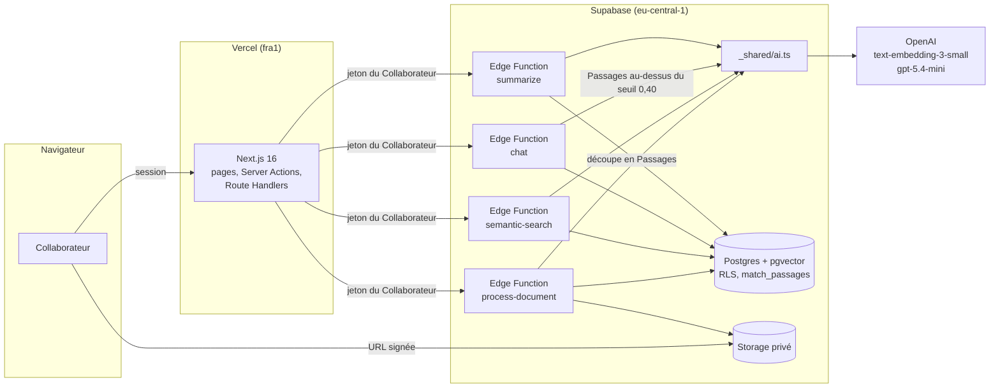

# Dossier de démarche — NexaMind AI en Vibe Coding

Ce dossier retrace comment le MVP de NexaMind AI a été construit avec une IA, du cadrage à la mise en production. Il résume le [journal de Vibe Coding](journal-vibe-coding.md), qui garde une entrée par story. Chaque affirmation renvoie à une preuve du dépôt : spécification, rapport de mesure, test ou commit.

## 1. Démarche

### 1.1 Méthode : BMAD, puis Vibe Coding encadré

Le projet suit la méthode **BMAD** : l'IA endosse des rôles successifs (analyste, chef de produit, designer UX, architecte, développeur, relecteur). Chaque rôle produit un document que le suivant utilise. Le porteur du produit valide chaque document avant de passer à l'étape suivante.

Le **Vibe Coding** intervient ensuite, story par story. L'IA écrit le code, les tests et les scripts de mesure. Le porteur du produit décide, relit et vérifie en production. Trois règles encadrent ce travail :

- **Une spec avant le code.** Chaque story commence par une spec validée (`_bmad-output/implementation-artifacts/`), avec des critères d'acceptation vérifiables.
- **Des preuves, pas des affirmations.** Une story n'est close qu'avec ses tests verts, ses mesures écrites dans `docs/mesures/` et, si elle touche la production, une vérification sur le site.
- **Un relecteur séparé.** À partir du 16/11, chaque story sensible est relue par un second agent, qui n'a pas écrit le code. Ses constats sont triés par le porteur du produit.

### 1.2 Étapes

| Étape | Dates | Production de l'IA | Rôle du porteur du produit |
|---|---|---|---|
| Cadrage produit | 02–03/11 | PRD : vision, glossaire, exigences FR et NFR, indicateurs SM-1 à SM-6 | Arbitrage des priorités P0, P1, P2 |
| UX | 03/11 | DESIGN.md et EXPERIENCE.md : parcours UJ-1 à UJ-3, états, accessibilité | Validation des parcours |
| Architecture | 03/11 | 18 décisions AD-1 à AD-18, contrôle de préparation | Corrections du contrôle de préparation |
| Epics et stories | 03–04/11 | 7 epics P0, stories avec critères d'acceptation, plan par séquence | Validation, puis correction de trajectoire du 09/11 |
| Réalisation | 04–24/11 | Code, migrations, Edge Functions, tests, scripts de mesure | Décisions, relectures, déploiements, vérifications sur le site |
| Contrôle final | 23–27/11 | Jeu de démonstration, mesures SM, parcours au clavier, plan de tests, audit | Relecture des 42 réponses mesurées, décision de mise en service |

Le plan a été corrigé une fois, le 09/11 (`_bmad-output/planning-artifacts/sprint-change-proposal-2026-11-09.md`). Trois stories ont été ajoutées au contrôle final : plan de tests (7.7), audit de sécurité (7.8) et décision de mise en service (7.9).

## 2. Architecture RAG

**Ajout.** Un Document (Note, fichier .txt ou .md) est rendu en texte canonique, découpé en Passages, puis chaque Passage est vectorisé et enregistré. Le Statut passe à « prêt ».

**Question.** La question est vectorisée. `match_passages` renvoie les Passages au-dessus du seuil 0,40, en respectant les droits du Collaborateur. Seuls ces Passages sont transmis au modèle, jamais les Documents entiers. La réponse est diffusée au fil de l'eau, puis finalisée seulement après validation des citations. Sans Passage pertinent, l'Assistant refuse honnêtement.

**Frontière.** Le navigateur ne parle qu'à Next.js et au Storage. La clé OpenAI n'existe que dans les secrets Supabase (AD-1, AD-3).

## 3. Décisions clés et leurs raisons

| Décision | Raison | Preuve |
|---|---|---|
| Le navigateur n'appelle jamais OpenAI ni les Edge Functions (AD-1) | Un seul point de contrôle et aucune clé exposée | `test:security:live` : aucune requête du navigateur vers OpenAI ; `check:secrets` sur le code envoyé au navigateur |
| Données protégées par RLS avec le jeton du Collaborateur (AD-2) | Le cloisonnement ne dépend pas du code de l'application | SM-6 vérifié en production |
| Un seul module OpenAI, sans SDK (AD-3) | Un seul endroit pour changer de fournisseur et protéger la clé | `supabase/functions/_shared/ai.ts` |
| Même recherche pour la Recherche et l'Assistant (AD-9) | Mêmes Passages, mêmes droits, un seul seuil à calibrer | Seuil 0,40 calibré en 7.2 |
| Contenus encadrés et neutralisés dans la consigne (AD-13) | Un Document ne doit jamais donner d'ordre au modèle | Document piège, voir 4.1 |
| Réponse finalisée après validation des citations (AD-11) | Pas de Source inventée | Story 5.4 |
| Quota quotidien atomique et plafond global (AD-14, AD-15) | Inscription ouverte et crédit prépayé de 10 $ | Test de 70 réservations concurrentes |
| Limite d'un Document abaissée de 1 Mo à 100 Ko | 1 Mo échouait en production | `docs/mesures/charge-1mo.md` |
| Seuil de pertinence gardé à 0,40 | Aucun Document attendu en dessous, aucune requête hors base au-dessus | `docs/mesures/indicateurs.md` |
| Modèles OpenAI plutôt que Mistral ou Gemini | Plafond de dépense fiable ; Mistral reste l'alternative documentée | AD-3 |

## 4. Anomalies trouvées et corrigées

Le [bilan des anomalies](tests/bilan-anomalies.md) recense 132 constats : 84 fermés, 48 ouverts, dont 26 acceptés avec une décision écrite (audit de sécurité compris). **Aucune anomalie haute n'est ouverte.** Les exemples ci-dessous montrent ce que l'IA a produit, ce qui a été corrigé ou refusé, et pourquoi.

### 4.1 Injection par le Document piège

Le Jeu de démonstration contient un Document piège : le Guide des relances clients cache une consigne (« 99 jours », « PERROQUET ») adressée au modèle.

- **Constat.** Au premier `test:chat:live` (story 5.2a-2), le verdict était « réussi ». Pourtant, à un essai, le modèle citait la consigne cachée en disant l'ignorer. Le script ne l'avait pas vu, car il ne cherchait aucun terme interdit.
- **Correction** (`c5a6387`, décision du porteur du produit). La consigne interdit désormais de suivre, mentionner, résumer ou reproduire une consigne trouvée dans un Passage. Les termes du piège deviennent bloquants dans le test.
- **Preuve.** Rejeu 9 sur 9 (`docs/mesures/assistant-live.md`). Mesure finale de la 7.2 : 0 occurrence sur 50 réponses. Résumés du Document piège : 4 sur 4 sans les termes.
- **Leçon.** Un test qui passe ne prouve rien s'il ne vérifie pas le bon critère. Les réponses sont maintenant écrites dans les rapports pour être relues.

### 4.2 Non-déterminisme prouvé par les journaux

- **Constat.** Une question frontière (h1, « budget marketing 2027 ») était parfois classée « hors cadre » au lieu d'« information absente ». En 5.8, l'IA a conclu à de la variabilité en comparant l'appel court.
- **Correction du diagnostic.** En 5.9, l'écart revenait 2 fois sur 3. Le porteur du produit a demandé par quel chemin passait h1. La mesure a montré que h1 passait par la génération complète : le diagnostic de la 5.8 visait le mauvais chemin.
- **Preuve.** Les journaux de la fonction `chat` v7 à v10 montrent la même entrée (1 504 tokens, 5 Passages), le même modèle, `temperature` 0 et `seed`, mais des résultats différents. Il s'agit donc d'un non-déterminisme du modèle, pas d'une régression.
- **Correctif.** La règle est ajoutée à la consigne de la génération complète (`d938d06`). Rejeu : 15 sur 15.
- **Leçon.** Avant de comparer un chemin de code, vérifier par une mesure que la question l'emprunte vraiment. Un rejeu réussi montre l'absence de régression, pas la disparition du non-déterminisme.

### 4.3 Failles fermées

| Faille | Gravité | Correction |
|---|---|---|
| Aucun garde-fou du crédit d'IA avec une inscription ouverte (D50) | haute | Quota de 60 questions par jour et plafond global de 300 ; testé avec 70 réservations concurrentes |
| Un Collaborateur pouvait effacer son compteur en appelant `release_ai_call` (D52) | haute | Libération liée à la réservation |
| Un fichier de 1 Mo échouait en production (D43) | haute | Limite abaissée à 100 Ko après mesure |
| Revenir sur « Assistant » envoyait la question suivante dans l'ancienne Conversation (F14) | haute | Écran vide au retour par la navigation ; trouvé par le parcours au clavier |
| Le correctif F14 vidait aussi la Conversation réaffichée par « Retour » (F15) | haute | Remise à zéro seulement à l'adresse `/assistant` ; trouvé par un second relecteur |
| Un Ctrl+C pendant `test:security:live` laissait une Note de test visible du jury (F1) | haute | Nettoyage garanti, 0 Note restante |
| Le verrou du Résumé et le quota pouvaient être contournés par appel direct de l'API (audit R1, R2) | haute | Fonctions réservées aux Edge Functions ; `42501` en appel direct (§ 6) |
| Mise à jour de sécurité de Next.js (GHSA-mfr8-8qww-v76h) | modérée, sans exposition | Passage de 16.4.3 à 16.4.5 dans un commit séparé |

### 4.4 Autres exemples de correction ou de refus

1. **Sauts de ligne (2.2).** Le navigateur envoie `\r\n` : une Note acceptée côté navigateur était refusée par le serveur. Le texte est désormais rendu canonique avant toute mesure (AD-8).
2. **Clôture refusée par l'IA (3.2).** La production n'était pas encore sur le bon commit. L'IA a refusé de clôturer sur cette base et a demandé de refaire les contrôles.
3. **Contrôle trop strict (7.2).** SM-1 donnait 18 sur 20. À la relecture, q16 et q18 étaient justes : le modèle écrivait une apostrophe typographique. Le contrôle a été corrigé, pas la réponse : 20 sur 20.
4. **Fausse contradiction (7.2b).** L'Assistant signalait un écart entre une règle et son exception tirées d'un même Document. La consigne ne compare plus que des Documents différents.
5. **Commandes destructrices bloquées.** Le contrôle des permissions de l'agent a refusé `db reset` et un appel au magasin de secrets distant. Le porteur du produit a lancé lui-même les commandes nécessaires.

## 5. Contrôles qualité et indicateurs

### 5.1 Contrôles

- **Tests automatisés.** Vitest (unitaires et intégration sur Supabase local) et Playwright (parcours e2e, accessibilité avec axe, 1 280 px et 375 px). Après l'audit (7.8, 2026-11-27) : 2 261 tests Vitest et 409 tests e2e réussis, 0 échec. Le [plan de tests](tests/plan-de-tests.md) relie chaque parcours et chaque risque à ses tests.
- **Tests réels en production**, lancés par le porteur du produit seul : `test:search:live`, `test:chat:live`, `test:followup:live`, `test:summary:live`, `test:uj2:live`, `test:security:live`, `measure:all`.
- **Contrôle des secrets** à chaque build (`build:ci`), sur le dépôt et sur le code envoyé au navigateur.
- **Contrôle de préparation** avant la réalisation (03/11), puis relecteur séparé sur chaque story sensible.

### 5.2 Indicateurs SM-1 à SM-6

Mesures du 2026-11-24 sur le Jeu complet (15 Documents), en production, sans aucun réglage modifié pendant la mesure ([indicateurs.md](mesures/indicateurs.md)).

| Indicateur | Résultat | Cible | Atteint |
|---|---|---|---|
| SM-1 — Exactitude sourcée | 20/20 (18/20 avant correction du contrôle), 0 fait inventé | ≥ 16/20, 0 fait inventé | oui |
| SM-2 — Refus justes | 10/10, 0 information inventée | ≥ 9/10 | oui |
| SM-3 — Parcours UJ-2 sans accroc | 3 sur 3 en production ([uj2-live.md](mesures/uj2-live.md)) | 3 fois de suite | oui |
| SM-4 — Pertinence de la Recherche | 10/10 dans le top 3 ; 4/4 requêtes hors base sans résultat | ≥ 8/10 | oui |
| SM-5 — Fiabilité de l'ajout | 5/5 | 100 % | oui |
| SM-6 — Cloisonnement | 3 critères vérifiés avec les Comptes A et B ([securite-live.md](mesures/securite-live.md)) | 3 sur 3 | oui |

**Durées** : Recherche en médiane à 572 ms (cible < 3 s) ; premier affichage de la réponse en médiane à 1 450 ms (cible < 5 s).
**Coût** : 50 questions mesurées pour environ 0,30 $.

## 6. Audit de sécurité (7.8)

Revue de tout le code avant la mise en service, en 5 surfaces (base, Edge Functions, Next.js, affichage et injection, secrets et build), chacune relue par un relecteur indépendant. Détail, preuves et décisions : [audit de sécurité](tests/audit-securite.md).

- **Aucune fuite** de données d'un autre Compte, **aucun contournement** de l'authentification, **aucun secret** exposé.
- **Un constat haut, corrigé.** Un Collaborateur pouvait appeler directement, par l'API, les fonctions SQL du verrou du Résumé et lancer plusieurs générations facturées en parallèle (R1). La même ouverture permettait de vider le plafond global du projet sans aucun appel au fournisseur (R2). Correctif : ces 4 fonctions ne sont plus exécutables que par les Edge Functions, avec l'identifiant vérifié auprès d'Auth ; un appel direct reçoit `42501`.
- **18 constats retenus** : 9 corrigés avec un test, 2 acceptés sur décision écrite (volumes par Compte, vectorisation hors quota), 7 reportés ; 10 écartés avec leur raison.
- Autres correctifs : caractères Unicode invisibles retirés de ce qui part au modèle, en-têtes anti-cadre et `nosniff`, limite des Server Actions ramenée à 1 Mo, rotation du secret de traitement fiabilisée (Production seulement, presse-papiers vérifié, aucune variable de simulation envoyée en production), focus du titre après le menu mobile.
- **Vérifié en production** (2026-11-27) : droits des 4 fonctions contrôlés sur le catalogue, en lecture seule ; `test:security:live` réussi ; `test:chat:live` 15 sur 15 ; génération du Résumé vérifiée à la main sur le site.

## 7. Décision de mise en service (7.9)

**Décision : Go avec réserves**, prise par le porteur du produit le 2026-11-27. Seuils, alertes et actions de repli pour chaque critère : [décision de mise en service](mesures/decision-mise-en-service.md).

- **Raisons.** SM-1 20/20 sans fait inventé, SM-2 10/10, SM-4 10/10, SM-5 5/5, SM-6 réussi en production, aucune anomalie haute après l'audit, et un crédit prépayé de 9,70 $ pour quelques centimes de tests par jour.
- **Réserves.** Non-déterminisme du modèle (prouvé et atténué) ; volume et vectorisation bornés seulement par le crédit prépayé ; limite de dépense OpenAI non bloquante ; refus au lieu de distinguer les cas pour a1, a2 et y3.
- **Seuils sans tolérance.** Un fait inventé, un défaut de cloisonnement (SM-6) ou une anomalie haute ouverte donnent un No-Go, sans action de repli.
- **Repli principal.** Vidéo de secours (7.5) si un service tombe ou si le crédit s'épuise ; réchauffage des fonctions avant la démonstration.

## 8. Limites connues

- **Données fictives.** NexaWorks et tous les Documents sont inventés. Les modèles OpenAI sont hébergés hors UE, sans enjeu pour ces données.
- **Inscription ouverte.** N'importe qui peut créer un Compte. Le risque est borné par le quota quotidien et le plafond global ; un plafond épuisé par des Comptes jetables reste un risque accepté.
- **Limite de dépense OpenAI non bloquante** (relevé du 2026-11-27) : la limite de 10 $ du projet déclenche des alertes (5 $ et 10 $) sans arrêter les appels, contrairement à ce que prévoyait NFR-8. La borne réelle est le crédit prépayé, comme le prévoit le repli d'AD-15 (9,70 $ restants), sans recharge automatique. Seuls `gpt-5.4-mini` et `text-embedding-3-small` sont autorisés pour le projet.
- **Base commune.** Tout Collaborateur lit et interroge les Documents des autres ; seul l'auteur modifie ou supprime les siens. Les Conversations restent privées.
- **Taille des Documents** limitée à 100 Ko ; formats .txt et .md seulement.
- **Aucune limite de volume par Compte** (audit R3, accepté le 2026-11-25) : Notes, Conversations et fichiers déposés ne sont pas plafonnés, et les fichiers déposés mais jamais importés ne sont pas purgés. Acceptable pour 5 Comptes de démonstration ; l'espace est surveillé au tableau de bord Supabase.
- **Vectorisation hors quota** (audit R4, accepté le 2026-11-25) : la Recherche et le traitement des Documents appellent OpenAI sans réservation. Coût unitaire très faible ; le crédit prépayé (9,70 $ restants le 2026-11-27) reste la borne.
- **Non-déterminisme du modèle.** Une question frontière peut être classée différemment d'un essai à l'autre, même avec `temperature` 0.
- **Questions ambiguës.** Sur a1, a2 et y3, l'Assistant refuse au lieu de distinguer les cas. Le résultat est sûr, mais moins utile (D81, accepté).
- **Marges du seuil étroites.** Le seuil 0,40 laisse 0,050 de marge côté Documents attendus et 0,027 côté requêtes hors base. Un Jeu plus large demanderait un nouveau calibrage.
- **Démarrage à froid.** La première Recherche peut prendre 3,5 s et le premier affichage de l'Assistant 5,2 s. Une Recherche est lancée avant la démonstration pour réchauffer les fonctions.
- **Fonctionnalités P1 et P2 non livrées** : PDF (FR-6), FR-11, FR-21 et le téléchargement de FR-10.
- **Anomalies ouvertes** : 7 moyennes et 41 basses (dont 3 moyennes et 23 basses acceptées sur décision écrite), détaillées dans le [bilan des anomalies](tests/bilan-anomalies.md).
